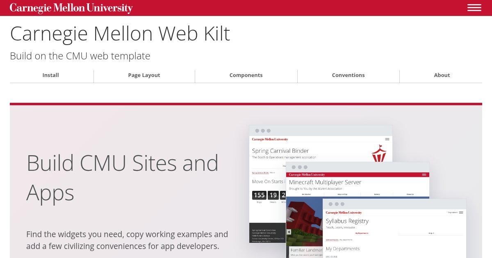

# Carnegie Mellon Web Kilt

**Made to Measure for CMU Sites and Apps**

Building a CMU website or app? The Web Kilt gives you components and working
examples that fit Carnegie Mellon's web template, from page layouts and
callouts to status pills, dialogs and file drop zones.

**[Explore the Documentation](https://webkilt.andrew.cmu.edu/)** ·
[Install the Kit](https://webkilt.andrew.cmu.edu/install.html) ·
[See It in Use](https://webkilt.andrew.cmu.edu/gallery.html)

The kit starts with what CMU's template already does, documents the markup
and adds components where you need more. Your CMS pages and custom apps can
share the same visual language without rebuilding the basics for each project.

It's two stylesheets and a browser script: plain CSS and JavaScript, with
no build step or required JavaScript framework. Use the pieces you need
alongside the template and keep your application's own data and behavior.

## Start With What You're Building

- **A CMS site:** [Add the kit to Cascade or another CMS](https://webkilt.andrew.cmu.edu/install.html#cms).
- **A web app:** [Use the kit with your stack](https://webkilt.andrew.cmu.edu/install.html#apps).
- **A prototype:** [Try it in a page](https://webkilt.andrew.cmu.edu/install.html#prototype).
- **With an AI coding agent:** [Connect the MCP server](https://github.com/cmu-web/cmu-web-kilt-mcp).

The docs have live examples, markup to copy and writing conventions to help
the whole page feel at home at CMU.

## Help Improve the Kit

[Report a problem or request a component](https://github.com/cmu-web/cmu-web-kilt/issues),
or read the [contributing guide](CONTRIBUTING.md) to work on the kit.
[Development](DEVELOPMENT.md) covers local setup and checks;
[Deployment](DEPLOYMENT.md) explains how releases are served.

## License

Copyright Carnegie Mellon University. The code and documentation use the
[BSD 3-Clause License](LICENSE). CMU's names, marks and Scotty artwork are
not covered by that license. CMU's web template is separate from this repository.
