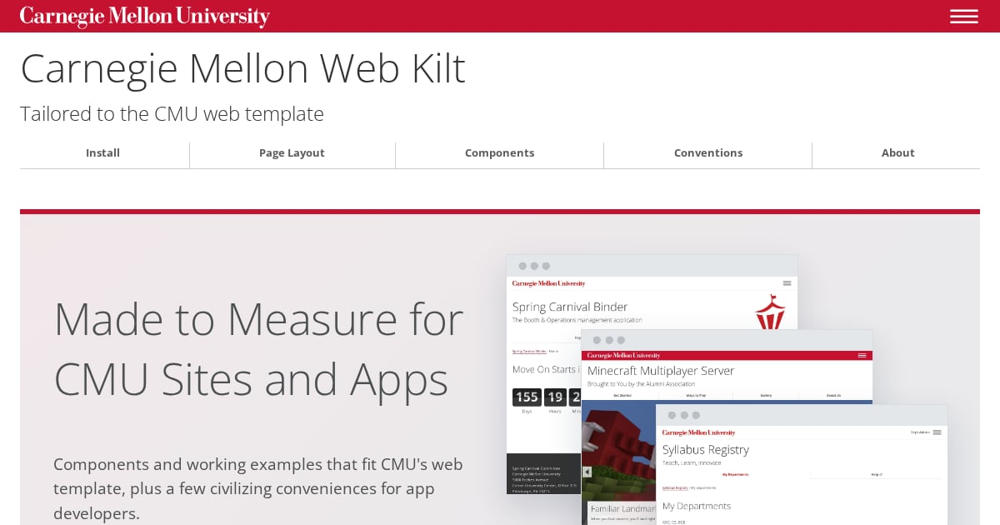

# Carnegie Mellon Web Kilt

The Carnegie Mellon Web Kilt gives you components and working examples that
fit Carnegie Mellon's web template, from page layouts and callouts to status
pills, dialogs and file drop zones, for CMU websites and apps.

Docs: https://webkilt.andrew.cmu.edu/

## Use It

The kit starts with what CMU's template already does, documents the markup
and adds components where you need more. Your CMS pages and custom apps can
share the same visual language without rebuilding the basics for each project.

It's two stylesheets and a browser script: plain CSS and JavaScript, with
no build step or required JavaScript framework. Use the pieces you need
alongside the template and keep your application's own data and behavior.

### Start With What You're Building

- **A CMS site:** [Add the kit to Cascade or another CMS](https://webkilt.andrew.cmu.edu/0/install.html#kit-install-cms).
- **A web app:** [Use the kit with your stack](https://webkilt.andrew.cmu.edu/0/install.html#kit-install-framework).
- **A prototype:** [Try it in a page](https://webkilt.andrew.cmu.edu/0/install.html#prototype).
- **With an AI coding agent:** [Connect the MCP server](https://github.com/cmu-web/cmu-web-kilt-mcp).

The docs have live examples, markup to copy and writing conventions to help
the whole page feel at home at CMU.
